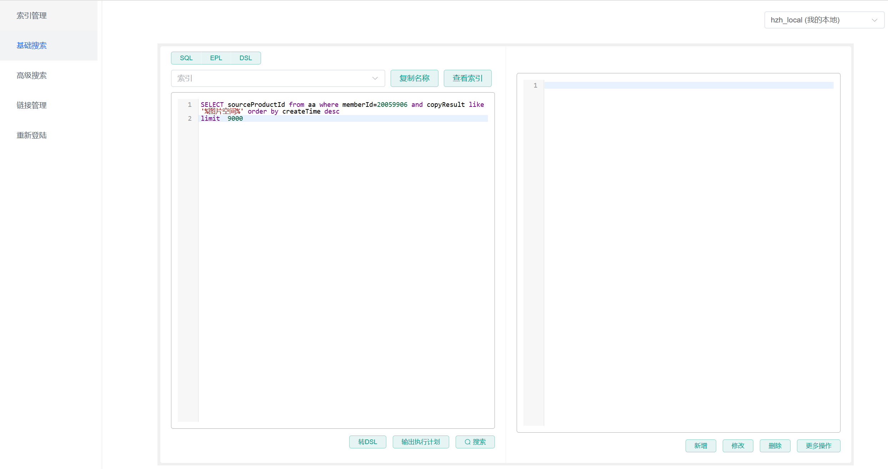
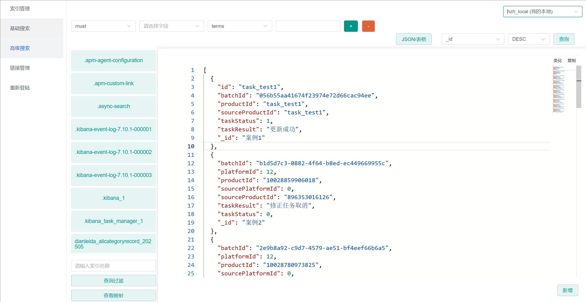

# Es-Plus - Elasticsearch Java Client 增强工具 | MyBatis-Plus 风格的 ES 操作库

<p align="center">
  <a href="https://github.com/zhaohaoh/es-plus/actions/workflows/build.yml">
    
  </a>
  <a href="https://search.maven.org/artifact/io.github.zhaohaoh/es-plus-spring-boot-starter">
    
  </a>
  <a href="https://www.apache.org/licenses/LICENSE-2.0">
    
  </a>
  <a href="https://github.com/zhaohaoh/es-plus">
    
  </a>
</p>

<p align="center">
  
  
  
  
</p>


<p align="center">
  <strong>简化 Elasticsearch 开发 | Lambda 链式查询 | 零侵入集成 | 代码量减少 60%</strong>
</p>

**关键词**: Elasticsearch Java Client, ES ORM, MyBatis-Plus 风格, Lambda 查询, Spring Boot 集成, 链式调用, Elasticsearch 封装

---

## 📖 简介

Es-Plus 是一款 **Elasticsearch Java Client 增强工具**，采用 **MyBatis-Plus** 风格的 API 设计，为 Java 开发者提供简洁优雅的 Elasticsearch 操作体验。

- 🎯 **面向对象**: MyBatis-Plus 风格的 Lambda 链式查询
- 🚀 **零侵入**: 基于 RestHighLevelClient 和 Elasticsearch Java Client 扩展
- 🔧 **开箱即用**: Spring Boot Starter 一键集成
- 📦 **多版本支持**: 兼容 Elasticsearch 6.7 / 7.8 / 8.17
- 💡 **简化开发**: 代码量减少 60%，告别繁琐的原生 API

适合正在使用 **Elasticsearch + Spring Boot** 的 Java 开发者，特别是熟悉 **MyBatis-Plus** 的团队。

## 🔍 为什么选择 Es-Plus?

如果你正在搜索:
- ✅ Elasticsearch Java 封装库
- ✅ Elasticsearch ORM 框架
- ✅ MyBatis-Plus 风格的 ES 客户端
- ✅ Elasticsearch Lambda 查询工具
- ✅ Spring Boot Elasticsearch 简化工具
- ✅ Elasticsearch RestHighLevelClient 增强

**那么 Es-Plus 就是你需要的!**

## ✨ 特性

- **无侵入**：在 rest-high-level-client和elasticsearch-java(es8)基础上扩展，只做增强不做改变，支持原生 API
- **融合 MyBatis-Plus 语法**：适用于习惯 MyBatis-Plus 语法和原生 ES 操作的开发者
- **优雅的聚合封装**：让 ES 聚合操作更加简单
- **内置所有分词器**：提供 ES 所有分词器和可配置 filters
- **多版本兼容**：支持 ES 6.7、7.8、8.17 多版本
- **Nested 嵌套查询**：使用 Lambda 表达式实现优雅的嵌套查询
- **静态链式编程**：无需依赖注入，直接使用静态类操作索引
- **多数据源支持**：通过 @EsIndex 指定默认数据源
- **自定义拦截器**：@EsInterceptors 注解支持执行前后拦截逻辑
- **ES 控制台**：类似 Navicat 的 ES 查询编辑工具

## 🖥️ 快速启动 Console / Client
- **Console（Java 版）**：项目根目录执行 `mvn -pl es-plus-console spring-boot:run`，启动后访问 `http://localhost:8080`。
- **Client（Windows 免 Java 版）**：进入 `es-plus-client` 执行 `npm run portable:windows`，然后运行 `desktop/dist/ES-Plus-Portable-0.1.0-x64.exe`。
- 两个版本均提供索引管理、SQL/EPL/DSL 查询和数据操作能力，Client 使用本地 Node.js 与 SQLite，无需安装 Java。
账号密码 admin 123456
**基础搜索界面**

**高级搜索界面**


## 📦 Maven 依赖

**ES 6.x / 7.x 版本：**
```xml
<dependency>
    <groupId>io.github.zhaohaoh</groupId>
    <artifactId>es-plus-spring-boot-starter</artifactId>
    <version>Latest Version</version>
</dependency>
```

**ES 8.x 版本：**
```xml
<dependency>
    <groupId>io.github.zhaohaoh</groupId>
    <artifactId>es8-plus-spring-boot-starter</artifactId>
    <version>Latest Version</version>
</dependency>
```

## 🚀 快速开始

### 第一步：配置连接信息

在 `application.properties` 中配置 Elasticsearch 连接：

```properties
# ES 地址（多个逗号分隔）- 默认数据源 master
es-plus.address=xxx.xxx.xxx.xxx:9200

# 查询最大数量限制
es-plus.global-config.search-size=5000

# 索引统一环境后缀
es-plus.global-config.global-suffix=_test

# 全局默认分词器（可选：ep_ik_max_word, ep_ik_smart, ep_standard 等）
es-plus.global-config.default-analyzer=ep_ik_max_word

# 全局 refresh 策略
es-plus.global-config.refresh-policy=wait_until

# 默认 ES ID 字段
es-plus.global-config.global-es-id=id

# 认证信息
es-plus.username=
es-plus.password=

# ES 版本（ES 8.x 必须指定为 8）
es-plus.global-config.version=7

# 多数据源配置（local 为自定义数据源名称）
es-plus.client-properties.local.address=localhost:9100
```

### 第二步：添加索引扫描注解

在 Spring Boot 启动类上添加 `@EsIndexScan` 注解：

```java
@SpringBootApplication
@EsIndexScan  // 必须添加：扫描并注册 ES 实体类索引
public class Application {
    public static void main(String[] args) {
        SpringApplication.run(Application.class, args);
    }
}
```

**作用**：
- 扫描带有 `@EsIndex` 注解的实体类
- 用于自动创建或更新索引字段

**注意**：
- 此注解仅用于索引管理（创建/更新）
- 不影响已有索引的查询操作

### 第三步：使用静态链式 API

Es-Plus 支持无需依赖注入的静态链式调用：

```java
@Service
public class UserService extends EsServiceImpl<User> {

    // 无实体类，直接操作索引
    public void saveWithMap() {
        Map<String, Object> data = new HashMap<>();
        data.put("id", "123456");
        data.put("username", "admin");
        Es.chainUpdate(Map.class).index("sys_user").save(data);
    }

    // Lambda 链式查询
    public void query() {
        EsResponse<User> response = Es.chainLambdaQuery(User.class)
            .term(User::getUsername, "admin")
            .list();
        System.out.println("查询结果：" + response.getList());
    }
}
```

---

## 💡 查询对比：es-plus vs 原生 ES

### es-plus 方式（10 行）
```java
EsResponse<User> response = userService.esChainQueryWrapper()
    .must()
    .term(User::getUsername, "admin")
    .ge(User::getAge, 18)
    .match(User::getText, "关键词")
    .sortByDesc(User::getCreateTime)
    .searchPage(1, 10);
List<User> list = response.getList();
```

### 原生 ES 方式（25 行）
```java
SearchSourceBuilder sourceBuilder = new SearchSourceBuilder();
BoolQueryBuilder boolQuery = QueryBuilders.boolQuery();
boolQuery.must(QueryBuilders.termQuery("username", "admin"));
boolQuery.must(QueryBuilders.rangeQuery("age").gte(18));
boolQuery.must(QueryBuilders.matchQuery("text", "关键词"));
sourceBuilder.query(boolQuery);
sourceBuilder.sort("createTime", SortOrder.DESC);
sourceBuilder.from(0);
sourceBuilder.size(10);

SearchRequest request = new SearchRequest("user");
request.source(sourceBuilder);
SearchResponse response = client.search(request, RequestOptions.DEFAULT);

List<User> list = new ArrayList<>();
for (SearchHit hit : response.getHits().getHits()) {
    list.add(JSON.parseObject(hit.getSourceAsString(), User.class));
}
```

**💡 代码量减少 60%，链式调用更简洁直观**

---

## 💡 聚合对比：es-plus vs 原生 ES

### es-plus 方式（10 行）
```java
EsResponse<User> response = userService.esChainQueryWrapper()
    .esLambdaAggWrapper()
    .terms(User::getUsername, e -> e.size(100))
        .subAgg(t -> t.sum(User::getId))
        .subAgg(t -> t.avg(User::getAge))
    .search();

Map<String, EsAggResult<User>> result = response.getEsAggsResponse()
    .getEsAggResult().getMultiBucketNestedMap("username_terms");
```

### 原生 ES 方式（26 行）
```java
SearchSourceBuilder sourceBuilder = new SearchSourceBuilder();
TermsAggregationBuilder termsAgg = AggregationBuilders
    .terms("username_terms").field("username").size(100);
termsAgg.subAggregation(AggregationBuilders.sum("id_sum").field("id"));
termsAgg.subAggregation(AggregationBuilders.avg("age_avg").field("age"));
sourceBuilder.aggregation(termsAgg);

SearchRequest request = new SearchRequest("user");
request.source(sourceBuilder);
SearchResponse response = client.search(request, RequestOptions.DEFAULT);

Terms usernameTerms = response.getAggregations().get("username_terms");
Map<String, Object> result = new HashMap<>();
for (Terms.Bucket bucket : usernameTerms.getBuckets()) {
    Sum sumAgg = bucket.getAggregations().get("id_sum");
    Avg avgAgg = bucket.getAggregations().get("age_avg");
    // 手动组装...
}
```

**💡 代码量减少 62%，自动封装结果无需手动解析**

---

## 💡 条件查询（动态查询）

根据参数动态添加查询条件，类似 MyBatis-Plus 的条件构造器：

```java
@Service
public class UserService extends EsServiceImpl<User> {

    public void conditionalQuery(String keyword, String username, Integer minAge) {
        // 参数为 null 时不添加该查询条件
        EsResponse<User> response = esChainQueryWrapper()
            .must()
            .match(keyword != null && !keyword.isEmpty(), User::getText, keyword)
            .term(username != null && !username.isEmpty(), User::getUsername, username)
            .ge(minAge != null, User::getAge, minAge)
            .searchPage(1, 10);

        List<User> list = response.getList();
        System.out.println("查询结果: " + list.size() + " 条");
    }
}
```

**💡 灵活的条件控制，避免手动拼接 if-else 判断**

---

## 💡 布尔查询组合

展示复杂的 must/should/mustNot 组合查询能力：

```java
@Service
public class UserService extends EsServiceImpl<User> {

    public void boolCombinationQuery() {
        // 实现：(必须年龄>=18) AND (用户名是admin或hzh) AND (排除已删除)
        EsResponse<User> response = esChainQueryWrapper()
            .must()
            .ge(User::getAge, 18)
            // 嵌套 should：用户名必须是 admin 或 hzh
            .must(wrapper -> wrapper.should()
                .term(User::getUsername, "admin")
                .term(User::getUsername, "hzh"))
            // 嵌套 mustNot：排除已删除的用户
            .must(wrapper -> wrapper.mustNot()
                .term(User::getDeleted, true))
            .searchPage(1, 10);

        List<User> list = response.getList();
        System.out.println("查询结果: " + list.size() + " 条");
    }
}
```

**💡 支持任意嵌套的布尔查询，等价于 SQL: WHERE age>=18 AND (username='admin' OR username='hzh') AND deleted!=true**

---

## 📚 ORM 映射方式

### 实体类定义

```java
@Data
@EsIndex(index = "sys_user")
public class SysUser {
    @EsId
    private Long id;

    @EsField(type = EsFieldType.KEYWORD)
    private String username;

    private String nickName;
    private Integer lockState;

    @EsField(type = EsFieldType.NESTED)
    private SysRole sysRole;
}
```

### 查询示例

```java
@Service
public class SysUserEsService extends EsServiceImpl<SysUser> {

    // 基础查询
    public void search() {
        EsResponse<SysUser> response = esChainQueryWrapper()
            .must()
            .terms(SysUser::getUsername, "admin", "hzh", "shi")
            .must(a -> a.should()
                .term(SysUser::getRealName, "张三")
                .term(SysUser::getPhone, "13800138000"))
            .list();

        List<SysUser> list = response.getList();
    }

    // 聚合查询
    public void aggregation() {
        EsResponse<SysUser> response = esChainQueryWrapper()
            .must()
            .terms(SysUser::getUsername, "admin", "hzh")
            .esLambdaAggWrapper()
            .terms(SysUser::getUsername, a -> a.size(10000))
            .subAggregation(t -> t.count(SysUser::getLockState))
            .search();

        EsAggregationsResponse<SysUser> aggResponse = response.getEsAggregationsResponse();

        // 获取聚合结果
        Terms terms = aggResponse.getTerms(SysUser::getUsername);
        Map<String, Long> termsMap = aggResponse.getTermsAsMap(SysUser::getUsername);
    }

    // Nested 嵌套查询
    public void nestedQuery() {
        EsResponse<User> response = esChainQueryWrapper()
            .must()
            .nestedQuery(User::getRoles, Role.class, wrap -> {
                wrap.mustNot()
                    .term(Role::getState, false)
                    .term(Role::getId, 2L);
            })
            .list();

        List<User> list = response.getList();
    }
}
```

---

## 💡 混用原生 ES API

框架支持 es-plus 混搭原生 ES 写法。

```java
// ES 8.x: 使用原生 Builder API
TermsQuery.Builder builder = new TermsQuery.Builder()
    .field("username").terms(b -> b.value(List.of(FieldValue.of("admin"))));

Es.chainLambdaQuery(User.class)
    .esQuery(new EpQueryBuilder().orginalQuery(builder))
    .term(User::getAge, 18)
    .search();

// ES 7.x: 使用 QueryBuilders
TermsQueryBuilder query = QueryBuilders.termsQuery("username", "admin");

Es.chainLambdaQuery(User.class)
    .esQuery(new EpQueryBuilder().orginalQuery(query))
    .term(User::getAge, 18)
    .search();
```

**💡 查询用 `EpQueryBuilder().orginalQuery()`, 聚合用 `EpAggBuilder().esOrginalAgg()`**

---

## 📌 版本说明

遇到版本冲突时，建议使用以下版本：
- **ES 6.x**：6.7.0
- **ES 7.x**：7.8.0
- **ES 8.x**：8.17

---

## 👨‍💻 作者

**微信**：huangzhaohao1995


---

## 📄 开源协议

[Apache License 2.0](https://www.apache.org/licenses/LICENSE-2.0)

